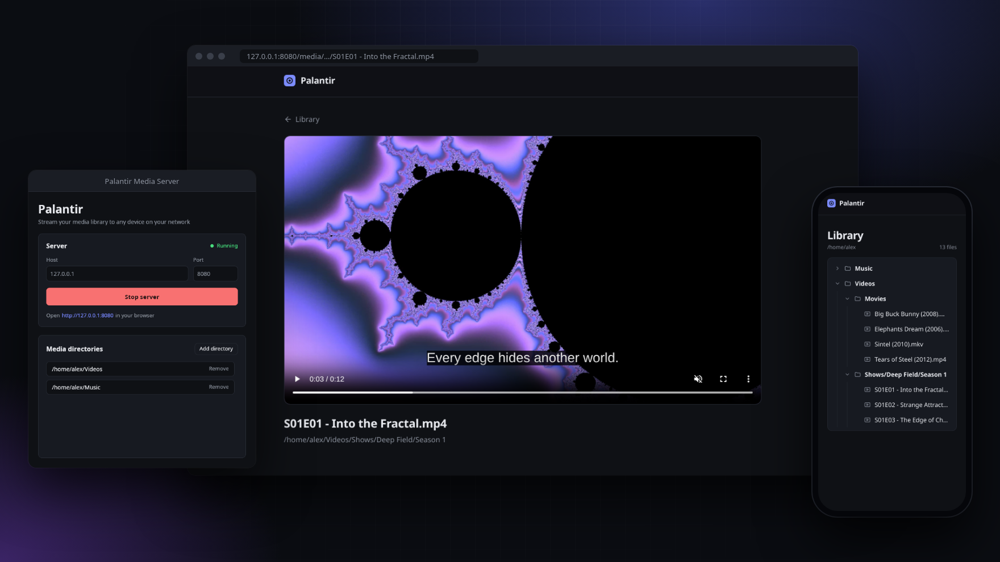
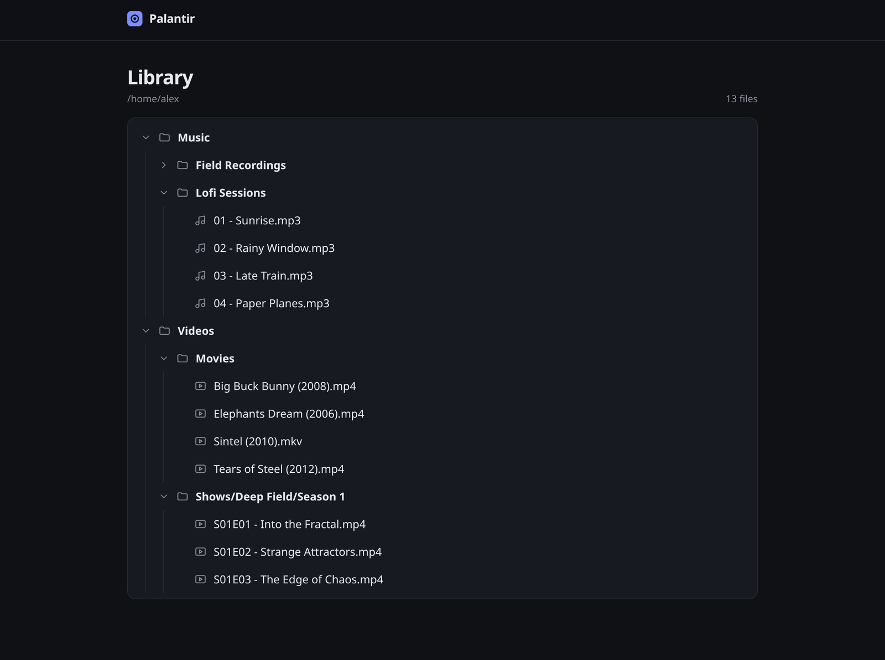
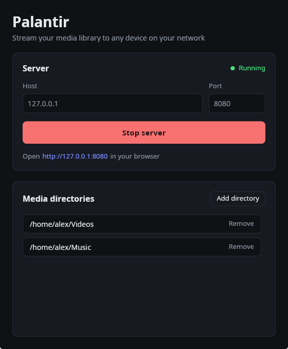
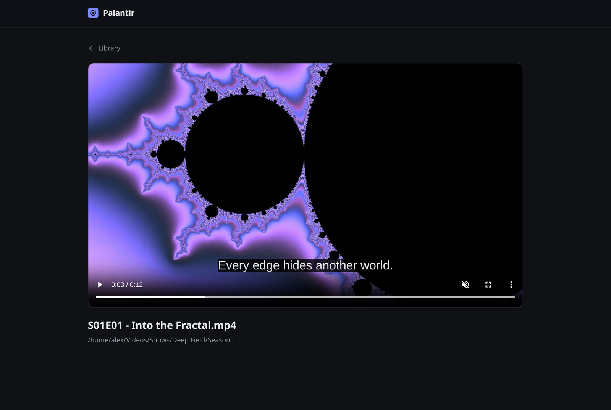
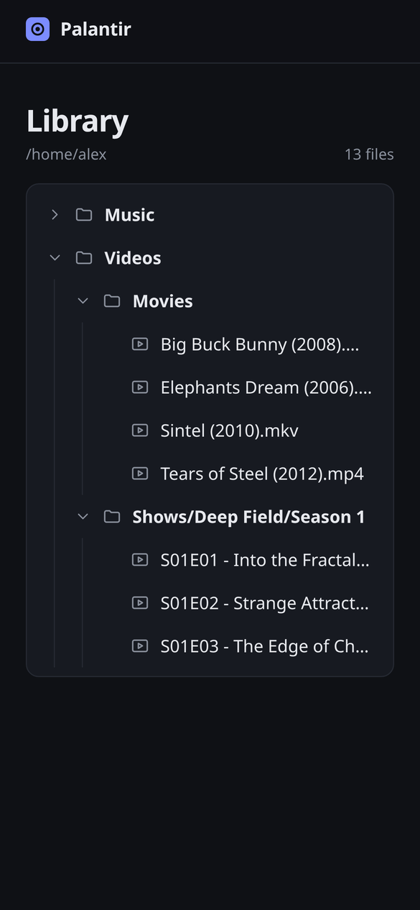
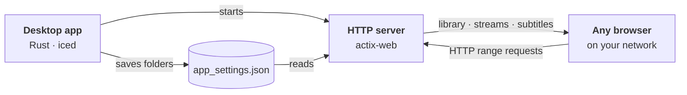

<div align="center">


# Palantir Media Server

**Stream your local videos and music to any device on your network.**<br />
A tiny desktop app with a clean web player: no account, no database, no setup.

[](https://github.com/benaissazaki/palantir-media-server/actions/workflows/api.yml)
[](https://github.com/benaissazaki/palantir-media-server/releases/latest)
[](https://github.com/benaissazaki/palantir-media-server/releases)


[**Download**](https://github.com/benaissazaki/palantir-media-server/releases/latest) ·
[Getting started](#getting-started) ·
[Building from source](#building-from-source) ·
[Roadmap](#roadmap)

<br />



</div>

## Why Palantir?

You have a folder of movies on your computer and want to watch one on your phone, tablet or TV browser. Most media servers make you install a service, create an account and wait while they build a library. Palantir is one small executable: pick your folders, press **Start server** and open the link.

- **⚡ Zero setup:** a single binary of about 20 MB, with nothing to install and no database.
- **📁 Your folders, as they are:** media is browsed as the folder tree you already have, sorted naturally, with single-child folders collapsed.
- **🎬 Built-in player:** videos and music play directly in the browser, with seeking.
- **💬 Subtitles:** `.srt` and `.vtt` files next to a video are picked up automatically. SRT is converted to WebVTT on the fly, with Latin-1 fallback for older files.
- **📱 Works everywhere:** a responsive web interface for desktop and mobile browsers, with nothing to install on the other device.
- **🔒 Safe by default:** only files inside your media folders can be served, and settings can only be changed from the computer running the app.

## Screenshots

<table>
  <tr>
    <td width="62%"></td>
    <td></td>
  </tr>
  <tr>
    <td align="center"><sub>Browse your library as a folder tree</sub></td>
    <td align="center"><sub>Pick folders and start the server</sub></td>
  </tr>
  <tr>
    <td></td>
    <td></td>
  </tr>
  <tr>
    <td align="center"><sub>Watch with subtitles, right in the browser</sub></td>
    <td align="center"><sub>Works on phones too</sub></td>
  </tr>
</table>

## Getting started

1. **Download** the latest release for your platform from the [releases page](https://github.com/benaissazaki/palantir-media-server/releases/latest):

   | Platform | File |
   | --- | --- |
   | Windows (64-bit) | `palantir-media-server-vX.Y.Z-win64.zip` |
   | Linux (x86_64) | `palantir-media-server-vX.Y.Z-linux.zip` |

2. **Extract** the archive and run `palantir-media-server.exe` on Windows or `./palantir-media-server` on Linux.
3. **Add your media folders** with **Add directory**. Palantir scans them, including subfolders, every time the library is opened.
4. **Start the server** and open the address shown in the app.

> [!TIP]
> The default host `127.0.0.1` only accepts connections from your own computer. To watch on **other devices**, set the host to `0.0.0.0` (or your computer's local IP address, such as `192.168.1.20`), start the server, then open `http://<your-computer-ip>:8080` on the other device. Your firewall may ask you to allow the connection.

## Supported formats

| Type | Extensions |
| --- | --- |
| Video | `.mp4`, `.mkv`, `.avi` |
| Audio | `.mp3`, `.wav` |
| Subtitles | `.srt`, `.vtt` |

Files are streamed as they are, without transcoding, so playback depends on what the browser supports. H.264, VP9 and AV1 video with AAC, MP3 or Opus audio play almost everywhere. Support for MKV files varies between browsers.

Subtitles are matched to videos in the same folder and can be picked from the player's captions menu.

## How it works



- The **desktop app** stores your folders in `app_settings.json`, next to the executable.
- The **server** scans those folders on request and streams files with HTTP range requests, so you can seek anywhere in a video.
- The **web interface** is a small React app served by the same server, so there is nothing else to run.

## Building from source

**Requirements:** [Rust](https://rustup.rs) (stable), [Node.js](https://nodejs.org) 18+ and [pnpm](https://pnpm.io) 8.

```bash
git clone https://github.com/benaissazaki/palantir-media-server.git
cd palantir-media-server

# Linux
./build-linux.sh

# Windows (PowerShell)
.\build-windows.ps1
```

The ready-to-run app is written to `build/`:

```
build/
├── palantir-media-server(.exe)   desktop app and server
├── app_settings.json             your media folders
└── client/                       web interface
```

### Development

```bash
# Build the web interface once; debug builds serve it from client/dist
cd client && pnpm install && pnpm build && cd ..

# Run the desktop app
cargo run
```

Run the tests with `cargo test -- --test-threads=1`. They share a settings file, so they need to run one at a time.

### Project structure

```
src/
├── main.rs              entry point
├── gui/                 desktop app (iced): views, state, messages, styles
└── server/
    ├── app_settings/    settings singleton, app_settings.json
    ├── media_scanner/   /api/media and /api/subtitles
    ├── media_server/    file streaming, SRT → WebVTT conversion
    └── react_app/       serves the web interface
client/                  web interface (React, TypeScript, Vite)
```

## Roadmap

- [x] Stream video and audio to any browser
- [x] Folder-based library
- [x] Subtitles (SRT and WebVTT)
- [x] Configure media folders from the app
- [ ] Transcoding for formats the browser can't play
- [ ] Search in the library
- [ ] Optional password protection

Ideas and bug reports are welcome in the [issues](https://github.com/benaissazaki/palantir-media-server/issues).

## Contributing

1. Fork the repository and create a branch from `master`.
2. Make your changes and run `cargo test -- --test-threads=1` and `pnpm lint` in `client/`.
3. Open a pull request with a short description of the change.

Commit messages follow the short `type: description` style used in the history, such as `fix: ...` or `feat: ...`.
